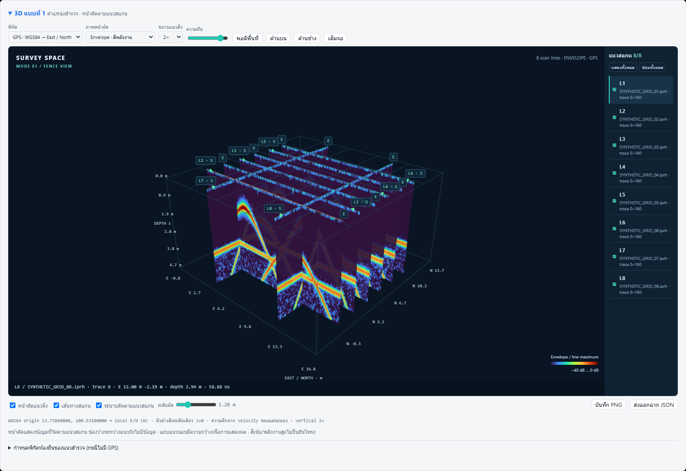

# 3D แบบที่ 1 — Survey fence view

## Context and scope

Requested 2026-10-23: display survey positions and every scan line in 3D, inspired by the user's
six GPR-SLICE screenshots and https://www.gpr-survey.com/. Baseline main: 2fb9bae (includes PR #9).
The reference homepage returned HTTP 403; screenshots are the visual reference.



| ID | User-visible acceptance criterion |
|---|---|
| R1 | Positioned lines become vertical radargram curtains, with labelled surface tracks, start/end and metre axes. Curved/reversed GPS tracks retain their acquisition order. |
| R2 | Orbit, pan, zoom, top/front/isometric views, per-line visibility, opacity, vertical exaggeration and grey/envelope/ViewPoint displays work locally without a CDN. |
| R3 | A movable horizontal slice shows signal on the measured scan tracks. Unsurveyed gaps stay empty. No isosurface, migration or inferred solid object is implied. |
| R4 | GPS uses one shared WGS84 local east/north frame. Missing navigation is listed explicitly; manual start/end coordinates can be saved in a separate local metre frame. Frames are never silently mixed. |
| R5 | Picking a curtain identifies source file, trace, time and depth and opens that line in the existing 2D review. PNG and scene JSON can be exported. |
| R6 | Time-to-depth uses core.depth_from_time, including antenna separation. Flat relative surface z=0 is labelled; no surveyed elevation or terrain is invented. |
| R7 | A clearly synthetic multi-line demo works; bad/missing navigation and save/restore are tested. Existing upload/review/report behavior remains functional. |

## Implementation plan

- `app/scene3d.py`: bounded scene payload, navigation validation/projection, textures, placement persistence.
- `app/server.py`: scene, layout and synthetic demo API; no change to detector/report schema.
- `app/static/survey3d.js` + CSS: isolated Three.js viewer; app.js dispatches job/line updates and accepts picks.
- Vendor Three.js 0.180.0 with MIT license, no CDN; package-data includes the new resources.
- `tests/test_scene3d.py`: geometry, depth, missing-data, persistence, API and packaging.

## Boundaries and assumptions

This is a fence plot of measured 2D sections, not a reconstructed continuous 3D subsurface volume.
Horizontal slices are narrow display strips along measured tracks; strip width is a display setting,
not antenna footprint. Default surface is a level relative datum; GPS heights are not terrain.
GPS gaps between valid fixes are interpolated by trace index. Data outside the first/last fix is
excluded, not extrapolated. Geographic scenes are limited to a 5 km local extent.
Manual local lines are straight endpoint interpolation in a user-defined common metre frame.
Image data is reduced for display; source radargrams and detection results are unchanged.
Isosurfaces, interpreted pipe drawing, terrain correction and 3D migration are later modes.

## Reference evidence

The visual reference is the supplied GPR-SLICE screenshots. This viewer is implemented independently
using this project's processed radargrams and navigation. No vendor code or imagery is included.

## Verification

Completed on Windows, Python 3.12.14, Chrome with software WebGL (SwiftShader):

| Requirement | Result / evidence |
|---|---|
| R1, R4 | Unit tests verify curved/reversed GPS, shared WGS84 origin, known 111.3195 m equatorial offset, dateline projection, navigation coverage and missing coordinates. |
| R2 | Browser QA verifies offline local dependencies, orbit changes the render, all/none visibility, envelope view and vertical exaggeration. |
| R3 | Browser QA verifies depth slider and curtains-off plan view. Gaps remain empty; strips sample the measured curtain texture at the requested depth. |
| R4 | API and browser verify local start/end persistence and reopening; invalid layouts leave the saved layout unchanged. |
| R5 | Browser QA verifies a real curtain raycast, the corresponding 2D trace cursor, and PNG/JSON downloads. |
| R6 | Nonzero antenna separation tested against core.depth_from_time; disabled time-zero without header reference excludes the line explicitly. |
| R7 | After integration with main 62ce567: full suite 219 passed, 6 skipped. Browser QA passed against the integrated app, including its background-processing flow. Five real-survey tests require GPR_REAL_DATA; one optional PDF inspection test requires pypdf. No real survey was tested in this run. |

Commands:

```powershell
python -m pytest -q
python -m pytest tests/test_scene3d.py -q
python -m gpr_analyzer.app --no-browser --port 8766 --workdir tmp/3d-jobs
# Requires playwright in Node resolution; optionally set BROWSER_EXECUTABLE / QA_URL / QA_OUTPUT.
node scripts/verify_scene3d.cjs
```

Browser QA artifacts: `tmp/scene3d-ui/verification.json`, three screenshots, exported PNG and scene JSON.
Wheel packaging is verified for the viewer JS/CSS and all four Three.js runtime/license resources.
Third-party Three.js 0.180.0 is served locally under its MIT license; no GPR-SLICE code/assets are included.

Known limits: 80 lines / 192 displayed traces / 160 displayed samples per line; level relative surface;
local GPS scene within 5 km of origin; no terrain/orthophoto drape, volume interpolation, isosurface,
interpreted object drawing or 3D migration. Existing detector/report and 2D depth-axis behavior is preserved;
their previously identified antenna-separation consistency question is a separate follow-up.

## Handoff

Branch `codex/3d-mode-1` was started from main 2fb9bae and integrated with main 62ce567 before the PR.
The synthetic demo uses the shared background-processing flow. Cropped lines retain bracketing GPS
fixes and expose both processed and source-file trace indices. Team review should start with
scene3d.py and the requirement table above, then run
the app with a real survey (raw files plus navigation) and check track direction/time-zero/velocity.
For long/multichannel surveys, verify navigation conventions and display budgets before expanding limits.
