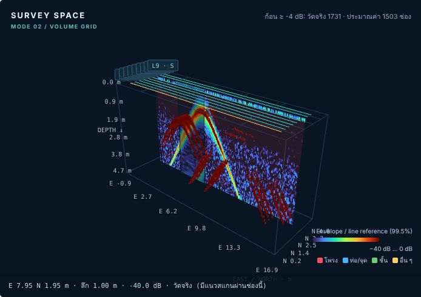

# 3D แบบที่ 2 — Volume grid from several lines

Requested 2026-10-26: a 3D display that does more than ImpulseRadar Condor, with accuracy first.
Builds on mode 1 (`3d-mode-1.md`). Select **มุมมอง → แบบที่ 2** in the 3D panel; the
**ลอง 3D แบบที่ 2** button loads a synthetic grid (nine parallel passes 0.5 m apart, a pipe across
all passes at 6 m and 1.0 m deep, a cavity under passes 4–6 at 10–12 m, roof 1.2 m).

## What it shows

- **Depth slice** through the gridded volume at any depth (slider steps by the grid's dz).
- **Vertical sections** at any east column and north row (Condor's cut-lines, but along the grid).
- **Voxels above a level** (−30…0 dB). If more than 120,000 qualify, the strongest are kept and the
  level actually drawn is shown.
- **Zones in 3D** in both modes: each zone is a wall along its own traces from its top to bottom depth,
  coloured by suspected type. Accepted/edited zones are solid, unreviewed are faint, rejected are hidden
  unless asked for. Reviewing a zone in 2D updates its colour in 3D without rebuilding the volume.
  Clicking a zone opens that line in 2D at the zone.
- **Readout** for any point on a slice: east, north, depth, dB, and whether that cell is measured,
  interpolated or empty.

## Accuracy rules (`app/volume3d.py`)

| Item | Rule |
|---|---|
| Position | Mode 1 GPS rules (interpolate between fixes, never past the first/last fix), plus: a fix gap longer than 5 m of travel is not bridged. Or the user's straight local layout. Same origin as mode 1. Reviewer-excluded sections are left out. |
| Depth | Each line's own time zero, velocity and antenna separation (`core.depth_from_time`); envelope resampled linearly to one depth axis (default dz 0.05 m). |
| Amplitude | Hilbert envelope ÷ that line's 99.5th percentile, in dB, floor −40 dB. Lines are gained separately, so this is relative energy, not reflectivity, not a probability. |
| Measured cell | At least one trace inside the cell (default 0.10 m). Mean per line, then mean over lines. |
| Interpolated cell | No trace inside, but it lies **between two different lines** (directions to their nearest measured cells more than 90° apart) whose distances add up to at most *max gap* (default 0.5 m, Condor's term). Value: inverse-distance² mean of measured cells within max gap. Drawn faded and can be hidden. |
| Empty | Everything else. Nothing is extrapolated beyond the outer lines or past line ends; one line alone never fills a cell. |

The percentages of measured / interpolated / empty cells are printed under the view and in the PNG.

## Compared with Condor (public manual and product page only)

| | Condor | Here |
|---|---|---|
| Input | Raptor multichannel swaths (dense) | Single-channel 2D lines with .cor GPS (CrossOver), or local layout |
| Gap filling | Bilinear per slice up to max gap | Only between two lines ≤ max gap; every cell labelled measured / interpolated / empty |
| Slices / cut-lines | Yes | Depth slice, east and north sections, voxels above a level |
| Automatic zones | No (manual interpretation) | Detected zones with review status, in 3D, linked to the 2D review |
| 3D migration | Stolt F-K | **Not done** (hyperbolas appear as arcs in the volume) |
| Depth-coloured top view | Osprey view | Codex PR #22 |
| Object export | .pobj/.lobj | Codex PR #24 |

## Not possible / not done

- A true continuous volume needs dense data. With 2D lines spaced more than the max gap, the space between
  them stays empty by design; we do not invent it. For Condor-like volumes, survey lines ≤ 0.25–0.5 m apart
  or use a Raptor array (array files are not read yet; no sample files).
- No 3D migration, no terrain/RTK elevation, one velocity per line.

## Verification

- `tests/test_volume3d.py` (9 tests): depth with each line's velocity and antenna separation; gap bridged
  only within max gap; no extrapolation past outer lines or line ends; single line never interpolates;
  nearer line weighs more; excluded sections and long GPS gaps stay empty; parameter and size limits;
  zones placed with their own depth; API; and end to end from written ImpulseRadar files the pipe is
  recovered at 1.0 ± 0.1 m across all passes and between them, and the cavity roof at 1.2 ± 0.1 m only
  under passes 4–6.
- Browser check (Chromium, SwiftShader WebGL): mode switch, build, depth slice, sections, voxels with and
  without interpolated cells, zone walls, readout; no page errors.
